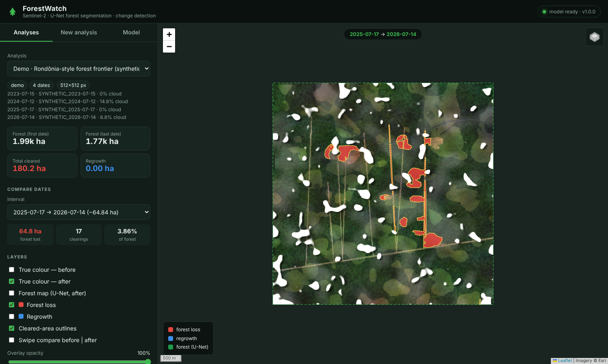
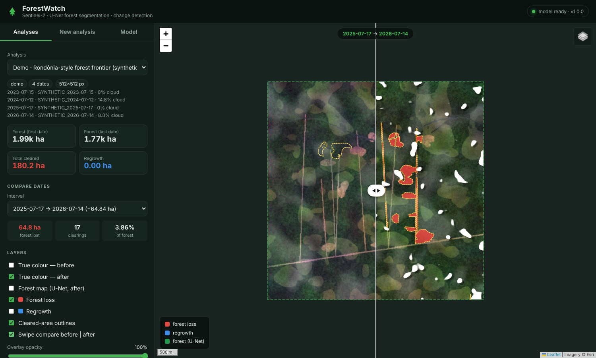
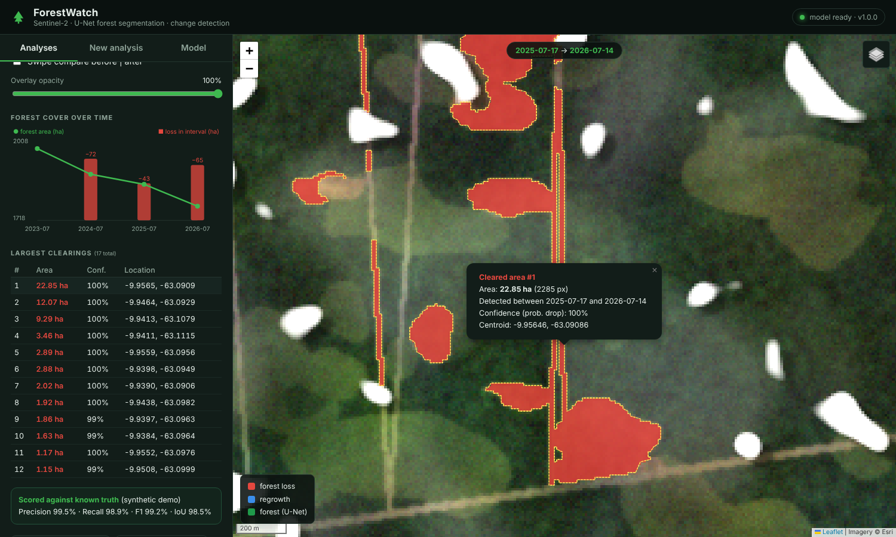
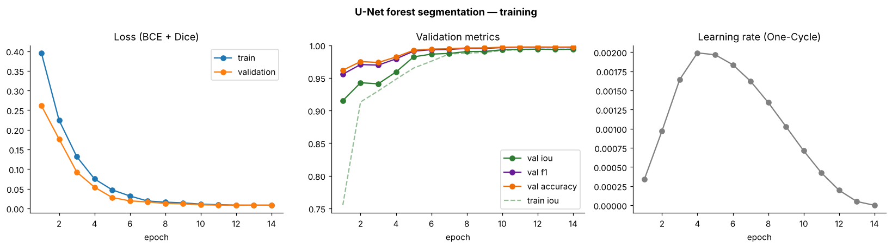
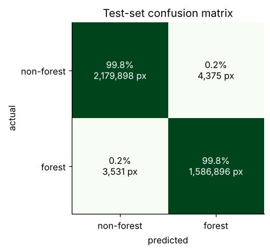
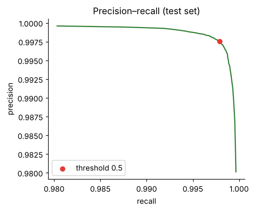
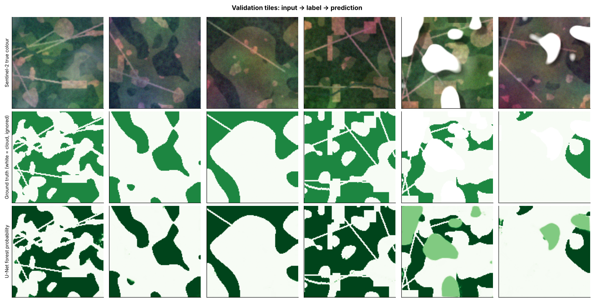
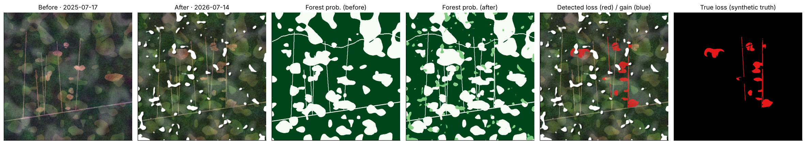
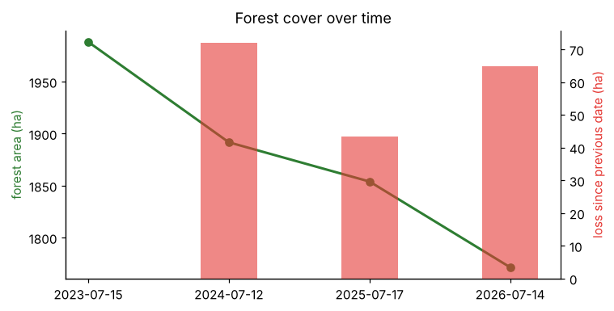

# 🌳 ForestWatch — Deforestation Detection from Sentinel-2 Satellite Images

Detect newly cleared forest from free **Sentinel-2** satellite imagery with a **U-Net**
segmentation model and **multi-date change detection**, then explore the results on an
**interactive web map**. Because Sentinel-2 photographs the same place every ~5 days,
the pipeline can keep tracking an area over time and raise alerts.



| Swipe before ↔ after | Click a clearing → zoom + details |
|---|---|
|  |  |

---

## ✨ Features

- **Real satellite data, free** — streams Sentinel-2 L2A from Microsoft Planetary Computer
  (STAC + Cloud-Optimised GeoTIFF). No account, no API key, downloads only your area.
- **U-Net forest segmentation** (PyTorch) on 6 bands: blue, green, red, near-infrared, 2× short-wave infrared.
- **Change detection** between any dates: forest loss *and* regrowth, confirmed by an NDVI drop,
  cloud/shadow-masked, cleaned, and turned into **GeoJSON polygons with area in hectares**.
- **Interactive map GUI** (FastAPI + Leaflet): draw an area, pick dates, run, then toggle layers,
  swipe-compare before/after, browse the largest clearings, download GeoJSON.
- **Time series + monitoring** — any number of dates; `src/monitor.py` re-checks a watchlist on a schedule and writes alerts.
- **Runs fully offline** — a built-in synthetic scene generator lets you train and demo without downloading anything.
- **Tested** — unit tests for the model, loss, change detection, vectorisation and the Sentinel-2 reader.

---

## 🚀 Quick start

```bash
git clone https://github.com/<you>/deforestation-detection.git
cd deforestation-detection
python -m venv .venv && source .venv/bin/activate      # Windows: .venv\Scripts\activate
pip install -r requirements.txt
```

The repo ships with a **trained model** (`models/unet_forest.pt`, ~8 MB) and a demo analysis,
so you can open the GUI straight away:

```bash
python -m app.server
# open http://localhost:8000
```

Or do everything from scratch in one go — `./run.sh` (Linux/macOS) or `run.bat` (Windows).

### Step by step

| Step | Command | Time (CPU) |
|---|---|---|
| 1. Generate training tiles | `python -m src.data.prepare_data` | ~1 min |
| 2. Train the U-Net | `python -m src.train` | ~25 min (2 cores) / ~2 min on a GPU |
| 3. Evaluate on test set | `python -m src.evaluate` | ~20 s |
| 4. Run the offline demo | `python -m src.pipeline --demo` | ~25 s |
| 5. Analyse a real place | `python -m src.pipeline --bbox -63.20 -10.00 -63.06 -9.88 --dates 2021-07-20 2024-07-20 --name Rondonia` | 1–3 min |
| 6. Start the GUI | `python -m app.server` | — |
| 7. Run tests | `python -m pytest -q` | ~5 s |

In the GUI, **New analysis → Real Sentinel-2** lets you draw a box anywhere on Earth
(up to ~15 × 15 km), pick two or more dates, and run. Presets for Rondônia, Pará and
Kalimantan are one click away.

---

## 📊 Results

### Training



Trained for 14 epochs on 1,400 synthetic 128×128 tiles (validation 250, test 250),
batch 16, AdamW + One-Cycle LR, BCE + Dice loss. ~1.94 M parameters.

| Held-out test set | Value |
|---|---|
| IoU | **99.50%** |
| F1 (Dice) | 99.75% |
| Precision | 99.73% |
| Recall | 99.78% |
| Pixel accuracy | 99.79% |

| Confusion matrix | Precision–recall |
|---|---|
|  |  |



### Change detection on the demo scene

The demo is a 5.1 × 5.1 km Rondônia-style forest frontier with four yearly dates: a highway,
new "fishbone" side roads, clearings along them, a large clearing, rivers and clouds.
Since it is synthetic, the true deforestation is known, so detection is scored against it:

| Interval | Forest lost | Clearings | Precision | Recall | IoU |
|---|---|---|---|---|---|
| 2023-07-15 → 2024-07-12 | 72.12 ha | 18 | 99.86% | 99.70% | 99.56% |
| 2024-07-12 → 2025-07-17 | 43.27 ha | 24 | 99.88% | 98.43% | 98.32% |
| 2025-07-17 → 2026-07-14 | 64.84 ha | 17 | 99.54% | 98.93% | 98.47% |

Total: **180.23 ha** cleared; forest cover 1988.2 ha → 1771.6 ha (cloud-corrected).




> **Honest note on the numbers.** These scores are on *synthetic* imagery. The generator
> deliberately adds mixed pixels, haze, terrain shading, spectral variation and
> forest-like regrowth to make the task realistic, but real Sentinel-2 scenes are messier.
> A first version of the generator was too clean — the model scored ~100% there and fell to
> **0.863 IoU** once the realistic effects were added, which is exactly why they were added.
> For real-world accuracy, fine-tune on real scenes (below) and validate against a reference
> map such as Hansen Global Forest Change or PRODES.

---

## 🗂️ Project structure

```
deforestation-detection/
├── app/
│   ├── server.py              FastAPI backend (REST API + background jobs)
│   └── static/                Leaflet front-end (index.html, app.js, style.css, vendored libs)
├── src/
│   ├── data/
│   │   ├── sentinel.py        STAC search + COG streaming of Sentinel-2 L2A
│   │   ├── synthetic.py       procedural Sentinel-2-like landscapes & time series
│   │   ├── prepare_data.py    builds train/val/test tiles
│   │   ├── build_real_dataset.py  real-imagery tiles with NDVI weak labels or a label GeoTIFF
│   │   └── dataset.py         PyTorch Dataset + augmentation
│   ├── models/
│   │   ├── unet.py            U-Net architecture
│   │   └── losses.py          BCE + Dice loss, IoU/F1 metrics (cloud pixels ignored)
│   ├── train.py               training loop, checkpoints, figures
│   ├── evaluate.py            test metrics, confusion matrix, PR curve
│   ├── predict.py             sliding-window inference with Hann blending
│   ├── change_detection.py    loss/gain masks, cleanup, polygons
│   ├── pipeline.py            end-to-end runner (demo or real bbox)
│   ├── monitor.py             scheduled re-checks of watchlist.yaml + alerts
│   ├── geo.py                 bbox/area maths, NDVI, PNG overlays
│   └── plots.py               all matplotlib figures
├── models/                    trained checkpoint + history + test metrics
├── outputs/runs/demo/         demo analysis (PNGs, GeoJSON, run.json)
├── docs/HOW_IT_WORKS.md       detailed explanation of every component
├── docs/images/               figures & screenshots
├── tests/                     pytest suite
├── config.yaml                every tunable parameter in one place
├── watchlist.yaml             areas for continuous monitoring
├── Dockerfile · run.sh · run.bat · requirements.txt
```

---

## 🧠 How it works (short version)

1. **Imagery** — For each date, search the Sentinel-2 L2A catalogue (±45 days, <20% cloud),
   pick the clearest scene, and stream bands B02, B03, B04, B08, B11, B12 for just your box,
   reprojected to lon/lat at 10 m. The Scene Classification Layer masks clouds and shadows.
2. **Segmentation** — The U-Net turns each image into a forest-probability map, sliding a
   128 px window with overlap and blending the windows so there are no seams.
3. **Change detection** — *was forest* AND *is not forest now* AND *NDVI dropped ≥ 0.15*,
   excluding clouds on either date, then patches under 0.1 ha are removed.
4. **Vectorisation** — patches become GeoJSON polygons with area, centroid and confidence.
5. **Map** — the GUI overlays true colour, forest map, loss/regrowth and outlines on a basemap.

👉 **Full explanation of every technology and design decision: [docs/HOW_IT_WORKS.md](docs/HOW_IT_WORKS.md)**

---

## 🔌 REST API

| Method | Endpoint | Description |
|---|---|---|
| GET | `/api/health` | server + model status |
| GET | `/api/model` | training history & test metrics |
| GET | `/api/runs` | list analyses |
| GET | `/api/runs/{id}` | one analysis (scenes, changes, stats) |
| DELETE | `/api/runs/{id}` | delete an analysis |
| POST | `/api/analyze` | `{"source":"sentinel","bbox":[W,S,E,N],"dates":["2021-07-20","2024-07-20"],"name":"…"}` or `{"source":"demo"}` |
| GET | `/api/jobs/{id}` | job status + live log |

Interactive docs: `http://localhost:8000/docs` (auto-generated by FastAPI).

---

## 🛰️ Using it on real data

```bash
# analyse
python -m src.pipeline --bbox -55.10 -6.60 -54.96 -6.48 --dates 2021-08-01 2024-08-01 --name "Para BR-163"

# fine-tune on real imagery (NDVI weak labels — or pass --labels your_forest_mask.tif)
python -m src.data.build_real_dataset --bbox -63.2 -10.0 -63.06 -9.88 --dates 2023-07-15 2024-07-15 --out data/real
python -m src.train --data data/real --resume models/unet_forest.pt --epochs 10

# monitor on a schedule (cron example: every Monday 06:00)
0 6 * * 1  cd /path/to/deforestation-detection && python -m src.monitor >> monitor.log 2>&1
```

Tips: use **dry-season** dates (Amazon: Jun–Sep; Borneo: Jul–Sep) for clear skies. Every
threshold (forest probability, NDVI drop, minimum area) is in `config.yaml`.

### Docker

```bash
docker build -t forestwatch .
docker run -p 8000:8000 forestwatch
```

---

## ⚠️ Limitations & next steps

- Trained on synthetic imagery — fine-tune on real scenes before relying on the numbers.
- Optical imagery can't see through clouds → add **Sentinel-1 radar** for the wet season.
- Selective logging under an intact canopy is hard to see at 10 m.
- Ideas: Siamese change network trained directly on image pairs, Hansen GFC labels, email/Telegram alerts, PostGIS storage.

## 🧰 Tech stack

Python · PyTorch · NumPy/SciPy · rasterio/GDAL · Shapely · pystac-client · Microsoft Planetary Computer ·
FastAPI · Pydantic · Uvicorn · Leaflet · Leaflet.draw · Matplotlib · pytest · Docker

## 📄 License

MIT — see [LICENSE](LICENSE). Contains modified Copernicus Sentinel data when run on real imagery.

**Author:** Fahad Basraa ([@FahaAhmed56](https://github.com/FahaAhmed56))
